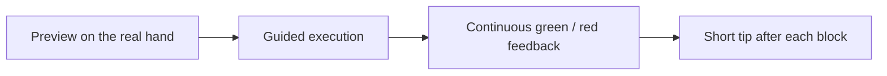

# MR Guided Hand Training

[← Back to profile](../README.md)

### Mixed reality guidance for hand motor training

MR Guided Hand Training is a research prototype for **guided hand motor training**. The user sees their own hand through passthrough while a semi-transparent reference hand, placed on the real hand, demonstrates the movement. During the exercise the reference hand turns green or red to show whether the movement follows the guide, including the transitions between positions.

Developed in research collaboration with the **University of Milano-Bicocca**, in the context of **COST Action CA24123**. It builds on the first-person movement guidance of Romano et al. (2021), *Neuropsychologia*, https://doi.org/10.1016/j.neuropsychologia.2021.107964.

## Training workflow

## Movements

- Opening and closing the hand
- Lifting the hand with the wrist resting on the table
- Touching each fingertip to the thumb in sequence

## Current stage

**Prototype v0.2.0 · Active development**

The current prototype covers all three movements with a participant interface in English and Italian. Feedback is rule-based and does not use AI. First on-device checks have been carried out on Meta Quest 3. Testing of the full exercise flow is ongoing.

This page provides a public overview of ongoing work. Source code and research data are not included.

*Research prototype in development. Clinical validation has not yet been conducted.*
