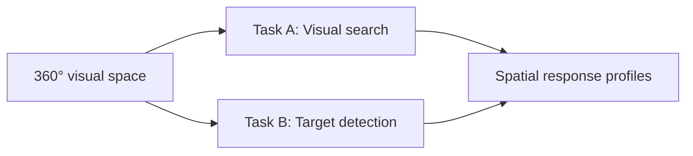

# XR Visual Assessment

[← Back to profile](../README.md)

### 360° mixed reality for spatial neglect assessment

XR Visual Assessment is a research prototype being developed for **spatial neglect assessment**. It investigates visual search and target detection across the space surrounding the user, with the aim of characterising spatial patterns of detection, omissions and response timing.

Developed in research collaboration with the **University of Milano-Bicocca**, in the context of **COST Action CA24123**.

## Research workflow

## Current stage

**Prototype v0.4.0 · Active development**

The current prototype integrates two complementary tasks: simultaneous visual search and sequential detection of static targets. Initial technical testing has been completed on Meta Quest 3.

This page provides a public overview of ongoing work. Source code and research data are not included.

*Research prototype in development. Clinical validation has not yet been conducted.*
